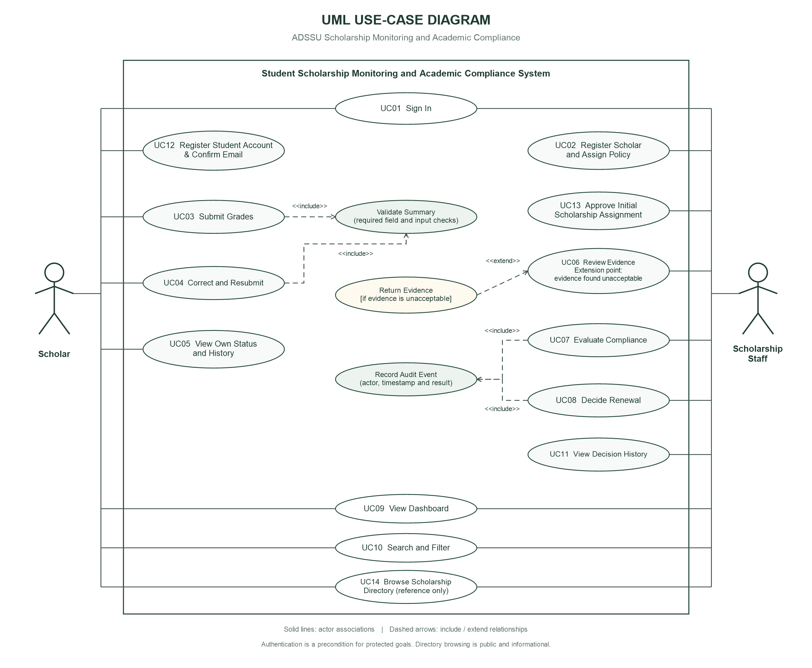

# Part I — Analysis and Design

**System:** Student Scholarship Monitoring and Academic Compliance System  
**Section:** B  
**Name / Student ID / Program and year / Date:** To be completed by the student

**ADSSU profile extension:** `database/04_adssu_profiles.sql` adds a separate academic-course catalogue and scholar course/year/section fields. Synthetic student IDs become M-008759–M-008764; B01–B06 remain test-case labels, not student IDs. All six fixtures display BSIT 3B, AY 2026-2027. Academic courses do not replace the two fictional scholarship policies or change the exam's thresholds. Source-backed offerings and older-listing limitations are documented in `ADSSU_PROGRAMS.md`.

**Student registration extension:** `database/06_student_registration.sql` adds email-confirmed student self-registration (UC12) and staff approval of the initial scholarship assignment (UC13). This is an additional user-requested feature, not a replacement for the exam's staff registration path. Only course/profile fields are student-entered; scholarship policy and staff authority remain staff/administrator controlled. The auth trigger no longer links an unconfirmed signup to an existing email-matched profile. First Scholar Login completes the profile after verified email ownership; unassigned scholars cannot submit grades. Live email-delivery and backend acceptance remain pending configuration and testing.

**Reference directory extension:** The app displays 21 public listings extracted from the user's other portal in a separate searchable directory. Names, reported grade labels and document lists are informational and not provider-verified; duplicates, conflicting thresholds and missing fields are flagged. This JSON-backed extension neither modifies nor substitutes the examination's two persisted scholarship policies and does not create external grant applications. See `OTHER_PROJECT_REVIEW.md`.

## A1 — Investigation and planning

### Problem statement

The Scholarship Office combines spreadsheets, email attachments and paper grade records to administer Excellence and Access scholarships. This fragmented process creates duplicate semester entries, unclear evidence status, missed deadlines and inconsistent renewal decisions. Scholars lack a reliable way to track progress. A browser-based system will centralize synthetic submissions, enforce program-specific policies, document verification and evaluation, and reserve renewal decisions for authorized staff.

### Problem–cause–effect analysis

| Problem | Cause | Effect |
|---|---|---|
| Duplicate semester entries | No shared stable scholar identifier or composite uniqueness constraint | Conflicting summaries and repeated review |
| Unverified evidence enters decisions | Documents and academic summaries are kept separately | Unsupported or premature renewal decisions |
| Late submissions are handled inconsistently | Manual timestamp comparisons and unspecified timezone | Unequal treatment and renewal delays |
| Scholars cannot track corrections | Decisions and requests are scattered across email and paper | Repeated inquiries and unresolved deficiencies |

### Scope and exclusions

Included: two authenticated roles; scholar registration and policy assignment; semester summaries and document references; correction and resubmission; verification; persisted policy checks; staff renewal decisions; semester dashboard, search, filters; immutable client-visible audit history; six fictional scholars and ten required test scenarios.

Excluded: official grade editing, Registrar integration, scholarship payments, SMS, machine learning, full appeals, policy exceptions, document uploads and public staff registration. Initial staff promotion and synthetic-account creation are administrator setup operations. Email-confirmed student signup is the optional extension described above. Policy administration and historical assignment versioning are not user-facing MVP features.

### Four development tasks

| Task | Time in development session | Output |
|---|---|---|
| D01 Establish schema, accounts and RLS | 0–15 minutes | Tables, policy records, private accounts and access controls |
| D02 Build assignments and submission workflow | 15–65 minutes | Registration, validation, verification and correction |
| D03 Build evaluation and reporting | 65–115 minutes | Persisted checks, controlled renewal, dashboard and history |
| D04 Test and package | 115–150 minutes | Test results, defects, screenshots, README and source archive |

### Two risks and responses

| Risk | Response |
|---|---|
| Hosting or internet failure prevents Supabase access | Retain local runnable frontend, SQL scripts and setup instructions; record the actual error; explain that the cloud backend still needs connectivity |
| Client manipulation exposes records or changes decisions | Apply database RLS, SELECT-only table grants, role/ownership checks inside RPCs, and direct backend-denial tests |

## A2 — Stakeholders and elicitation

| Stakeholder | Interest | Actual application actor? |
|---|---|---|
| Scholar | Submit academic summaries and see progress and decisions | Yes: Scholar |
| Scholarship Staff | Verify evidence, apply policy, decide renewal and monitor workload | Yes: Scholarship Staff |
| Registrar | Remain source of official academic evidence | No: no Registrar integration or direct system access in scope |
| Scholarship Office head / institutional management | Accountability, consistent renewal practice and aggregate reporting | No separate actor in this MVP; authorized operational users use Staff |

Six open-ended questions:

1. How do staff determine whether a grade-document reference is authentic and matches the academic summary?
2. How should corrections be submitted, and what feedback helps a scholar resolve returned evidence?
3. How are deadlines communicated, and which timestamp should determine timeliness after a correction?
4. How are policy exceptions currently requested and authorized, and which should remain outside this MVP?
5. What information does each role need, and what must remain inaccessible to another scholar?
6. What semester-level counts, filters and decision history are needed to monitor renewal work?

The exam policy answers take precedence over elicitation assumptions. Explicit design choices: the latest resubmission timestamp governs lateness; decisions reset when evidence/evaluation changes; assignments lock after the first submission. These choices should be confirmed with the instructor if another interpretation is required.

## A3 — Requirements and business rules

### Ten testable functional requirements

| ID | Requirement and observable acceptance condition |
|---|---|
| FR01 | Authenticate Scholar and Staff accounts. A scholar's backend query for another scholar's submission/history returns no rows, and verification/renewal RPCs reject Scholar callers. |
| FR02 | Staff register a unique student ID and email and assign one persisted program. The saved scholar and assignment remain visible after reload. Pre-submission reassignment is allowed; post-submission reassignment is rejected. |
| FR03 | Display both persisted policies and evaluate using the program linked to the submission, not browser constants. B03 passes the Access policy with one dropped subject. |
| FR04 | An assigned scholar can submit year, semester, GWA, units, failed/INC/dropped counts and a nonblank evidence reference; the database generates the timestamp and Pending verification status. Invalid values are rejected. |
| FR05 | Reject a second submission for the same scholar, academic year and semester; concurrent requests are covered by database uniqueness. Show a clear duplicate message. |
| FR06 | Staff mark pending evidence Verified, or return pending/verified evidence with a reason. Evaluation before verification is rejected. |
| FR07 | A scholar may correct their own Returned submission only. On resubmission it is Pending and Not Evaluated with Undecided renewal, and earlier history remains readable. |
| FR08 | Staff evaluate only verified evidence. Persist and display all policy-check outcomes and every deficiency reason; B04 shows both insufficient units and incomplete grades. |
| FR09 | Staff explicitly record Approved or Held with decision notes. Approval requires verified, Compliant evaluation. A scholar cannot alter decisions, and a deficiency does not automatically deactivate the award. |
| FR10 | Display semester counts for all assigned scholars, Pending, Compliant and With Deficiency; allow ID/name search and program/compliance filters. Persist verification, evaluation and renewal audit entries with actor, timestamp, notes and record snapshot. |

### Four measurable non-functional requirements

| ID | Target | Measurement |
|---|---|---|
| NFR01 Security | Zero unauthorized rows returned and zero successful staff-only mutations for the role-isolation checks | Run TC08 against the real authenticated database role and repeat through a scholar's browser token |
| NFR02 Performance | Render the six-record dashboard within 3 seconds after API responses finish; primary actions return feedback within 5 seconds on a working connection | Browser timing during local demonstration, excluding external network outage |
| NFR03 Usability | Core forms usable at 375px and 1280px viewport widths with keyboard-accessible labels; no page-level horizontal overflow | Resize browser and tab through login/submission; tables may scroll within their own container |
| NFR04 Integrity and durability | All ten scripted workflows preserve valid state; every successful verification/evaluation/renewal has an actor/timestamp history entry and survives refresh | Backend tests plus refresh checks and inspection of history |

These are acceptance targets, not claims of completed live measurement.

### Six business rules

| ID | Rule |
|---|---|
| BR01 Role and privacy | Scholars access only their own academic records. Staff register/assign, verify, evaluate and decide; account roles are administrator-controlled. |
| BR02 Submission integrity | One submission per scholar/year/semester. GWA is 1.00–5.00 inclusive with at most two decimals; units and counts are nonnegative integers. A nonblank document reference is mandatory. |
| BR03 Program-specific academic policy | Excellence: GWA ≤2.00, units ≥18, failed=0, INC=0, dropped=0. Access: GWA ≤2.50, units ≥15, failed=0, INC=0, dropped≤1. Use the persisted assigned program. Smaller GWA is better. |
| BR04 Timeliness | Both deadlines are 2026-11-06 17:00 Asia/Manila. Timestamp equal to deadline is on time; later is late. Latest resubmission time governs timeliness and earlier versions remain in history. |
| BR05 Evidence and evaluation | Missing/unverified evidence blocks final evaluation. Returned evidence may be corrected and becomes Pending again. After verification, any failed academic or deadline check yields With Deficiency with all reasons; otherwise Compliant. |
| BR06 Renewal and state separation | Only staff explicitly approve or hold an evaluated record; approval requires Compliant. Verification, compliance, renewal and award status are distinct. Evidence changes or re-evaluation clear stale renewal decisions. No evaluation automatically disqualifies a scholar; exceptions are excluded. |

## A4 — UML use-case model

Diagram: `docs/use-case-diagram.png`. The Scholar actor is on the left, Scholarship Staff is on the right, and all use cases are inside the central system boundary. It contains 14 identified user goals, two mandatory reused behaviors and a conditional Return Evidence extension. The diagram reflects the current application, including the optional self-registration, staff assignment and reference-directory extensions.

Editable vector: `docs/use-case-diagram.svg`. PlantUML semantic source: `docs/use-cases.puml`. The exact PNG/SVG layout is generated by `scripts/render-use-cases.ps1`; the two image exports share the same layout coordinates.

### Relationship justifications

- **Submit Grades → Validate Summary (`include`)**: every submission must validate its academic values, term and evidence. Correct and Resubmit includes the same mandatory validation behavior.
- **Evaluate Compliance → Record Audit Event (`include`)**: successful evaluation must record actor, time and results atomically. Decide Renewal includes the same mandatory audit behavior. Verification is also audited in implementation; its audit link is omitted from this diagram to avoid unnecessary connector clutter.
- **Return Evidence → Review Evidence (`extend`)**: at the `evidence found unacceptable` extension point, a staff reviewer conditionally returns evidence with a reason rather than completing verification. Its arrow points from Return Evidence to Review Evidence. A later scholar correction is a separate goal, not a conditional extension of the original submission.

Authentication is a precondition for protected use cases, not an artificial include on every goal. Login is shown as a standalone user goal. Staff verification is the normal acceptable-evidence outcome of Review Evidence; return is the conditional outcome.

## A5 — Detailed use cases and data design

### UC03 — Submit Grades

**Primary actor:** Scholar.  
**Trigger:** Scholar selects Submit for verification.  
**Preconditions:** Authenticated Scholar profile; persisted scholarship assignment; selected year and semester.  
**Linked requirements:** FR01, FR03, FR04, FR05, FR07.  
**Linked rules:** BR01, BR02, BR04, BR05.

Main flow:

1. Scholar selects an academic year and semester.
2. System displays GWA, unit/count and document-reference fields.
3. Scholar enters an academic summary and evidence reference.
4. System validates field types, ranges, year format and required evidence.
5. Backend verifies the actor and assignment and rejects a duplicate scholar/year/semester combination.
6. Backend saves a new submission with the assigned program, server timestamp, Pending verification, Not Evaluated compliance and Undecided renewal.
7. Backend appends an actor/timestamp snapshot in the same transaction.
8. System confirms receipt and displays the saved record.

Alternative flows:

- A1: A Returned record is opened under UC04 Correct and Resubmit. The scholar edits its summary/reference; the backend keeps its term and ID, generates a new submission timestamp, clears stale evaluation/decision values, and records another history entry.
- A2: A submission after the deadline is accepted as evidence for review. Once verified, evaluation reports Late submission rather than silently preventing submission.

Exception flows:

- E1: Invalid GWA/counts/year or blank evidence: show a clear message and do not save.
- E2: Duplicate term: the unique constraint rejects it; show the duplicate message and preserve the original record.
- E3: Missing assignment or unauthorized actor: deny the operation without partial writes.
- E4: Network failure: show the error. Refresh before retrying if the request outcome is uncertain; uniqueness prevents a second record.

**Postcondition:** Exactly one valid term record is persisted with Pending verification and an audit entry; no official grade or payment is changed. On failure, no partial submission/history is committed.

### UC07 — Evaluate Compliance

**Primary actor:** Scholarship Staff.  
**Trigger:** Staff selects Evaluate compliance on a submission.  
**Preconditions:** Authenticated Staff; existing submission with nonblank evidence and Verified status; linked persisted policy.  
**Linked requirements:** FR01, FR03, FR06, FR08, FR09, FR10.  
**Linked rules:** BR01, BR03, BR04, BR05, BR06.

Main flow:

1. Staff opens a submission and reviews its summary, document reference and verification result.
2. Staff requests evaluation.
3. Backend checks staff authority and locks the submission against concurrent modification.
4. Backend confirms verified evidence and retrieves the submission's persisted program policy.
5. Backend compares GWA, units, failed count, INC count, dropped count and submission timestamp with the six policy conditions.
6. Backend collects every failed condition; no failed checks means Compliant, otherwise With Deficiency.
7. Backend stores all checks, reasons and compliance, resets stale renewal to Undecided, and records an actor/timestamp snapshot atomically.
8. System displays the final result and each policy comparison.

Alternative flows:

- A1: One or several conditions fail: persist With Deficiency and all specific reasons; keep award status unchanged.
- A2: Exact maximum GWA, minimum units or deadline: equality passes the relevant check.
- A3: Staff reevaluates a verified record: append history and require a fresh explicit renewal decision.

Exception flows:

- E1: Pending/Returned or missing evidence: block final evaluation without altering compliance/history.
- E2: Scholar calls the RPC directly: reject with Staff access required.
- E3: Missing submission/policy or database error: abort the transaction and show the error.

**Postcondition:** A verified record has a stored, reproducible compliance result and complete checks/history. Renewal remains a separate staff action, and award status is unchanged.

### ERD and integrity

Source: `docs/erd.mmd`. Core entities: `profiles`, `programs`, `assignments`, `submissions`, `history`, with `academic_programs` as a separate ADSSU catalogue extension. Core UUIDs are stable primary keys; academic courses use stable internal code keys. Auth user linkage is nullable so staff can register/seed a scholar before an administrator creates the login account.

- One profile has zero or one current assignment; one program has many assignments.
- One assignment has zero or many semester submissions; each submission links to exactly one program.
- One submission has many immutable-to-clients history events; every event has one actor profile.
- Unique `(scholar_id, academic_year, semester)` prevents duplicate terms.
- Database checks constrain academic ranges/status values and prevent an Approved record unless Verified and Compliant.
- History snapshots retain previous verification, academic values, evaluation and decision notes when current state changes.
- RLS restricts reads; protected transactional RPCs are the only authenticated-client mutation path.

## A6 — Traceability

| FR | Actor | Use case | Business rules | Implemented screen/function | Test and expected result |
|---|---|---|---|---|---|
| FR01 | Scholar / Staff | UC01 Sign In; UC06 Review Evidence | BR01 | Login; database RLS, `is_staff`, table grants | TC08: another scholar's rows invisible; verification and direct writes denied |
| FR04 | Scholar | UC03 Submit Grades | BR02, BR04 | Summary form; `submit_grades` | TC07: invalid input rejected; valid submission gets timestamp and Pending status |
| FR08 | Staff | UC07 Evaluate Compliance | BR03, BR04, BR05 | Submission detail checks; `evaluate_submission` | TC04: exactly insufficient units and INC reasons; TC06: pending evaluation blocked |
| FR09 | Staff | UC08 Decide Renewal | BR01, BR06 | Renewal form; `decide_renewal` | TC10: Compliant can be Approved, deficient can be Held but not Approved; Scholar denied |

**Implementation status:** All ten FRs have corresponding code and database paths. Live acceptance is pending a configured Supabase project, real authentication sessions and browser evidence. No claim is made that unexecuted tests passed. No planned in-scope FR was intentionally omitted; limitations and excluded features are documented in README. Rendering diagrams, filling student information, providing private account access and recording actual functional results remain submission tasks.
